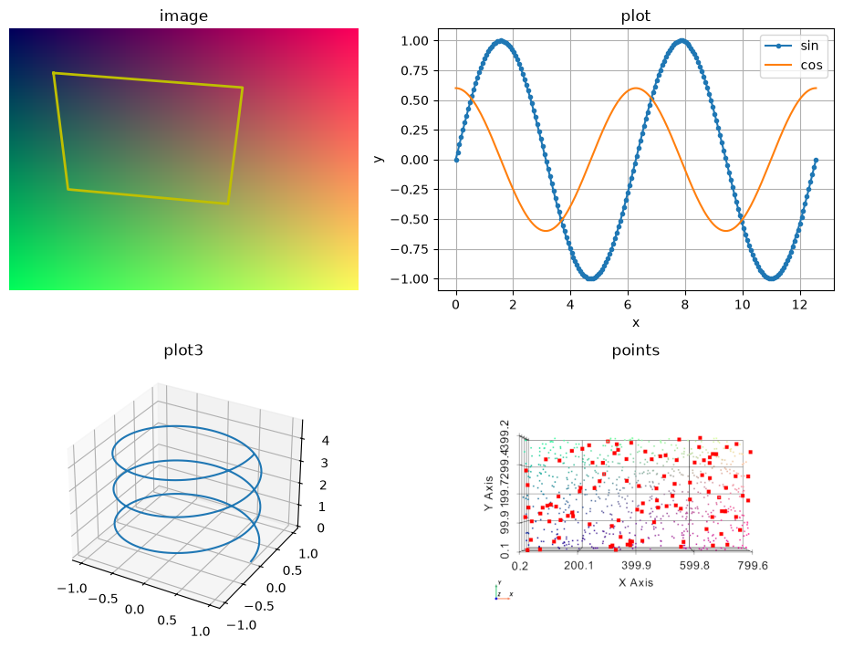

# cogmatplot

I often like to work with many types of plots and viewers (and miss the versatility of MATLAB figures) when doing research, so I made this library for Python. 
One grid can hold images, 2D plots, 3D lines, and point clouds. Each tile picks its own viewer: matplotlib, an OpenCV window, or a PyVista 3D view. `FigureManager(rows, cols, mon)` places 
that grid on any monitor; use a different `mon` when you want another screen. Heads up:The library is intended for development and debugging workflows, not end-user applications.

Example of 2x2 grid plotted with `inline` backend (from `examples/scene.py`). In `Qt` mode the same four cells are separate windows on the monitor you choose.



Pick where the figures go:

- **Inline** draws static figures in a notebook or interactive window.
- **Qt** opens interactive windows on a monitor. You can pan, zoom, and orbit.
- **Server** lets another process send the same calls to those windows.

## Install

```bash
pip install -e .
```

or `pip install -r requirements.txt`. That installs the viewers with the library:

| Package | Used for |
| --- | --- |
| `numpy`, `matplotlib` | 2D plots, images, and inline figures |
| `PyQt5` | Pop-out windows on a monitor |
| `pyvista`, `pyvistaqt` | Interactive 3D points and meshes |
| `opencv-python` | Fast live image tiles |
| `screeninfo` | Which monitor a tile lands on |
| `pyzmq` | The debug server |

## Quickstart

Call `use` before importing `FigureManager`.

### Notebook or interactive window

Figures stay in the output. They are not interactive.

```python
import numpy as np
import cogmatplot

cogmatplot.use("inline")
from cogmatplot import FigureManager

x = np.linspace(0, 2 * np.pi, 200)
image = np.zeros((120, 160, 3), np.uint8)
image[:, :, 1] = 180

fm = FigureManager(1, 2)
fm.imshow(0, 0, image, title="image")
fm.plot(0, 1, x, np.sin(x), ".-", label="sin", xlabel="x", ylabel="y")
fm.drawnow()
```

Open `examples/notebook_inline.ipynb` for the same idea with a 3D line and a point cloud.

### Interactive windows on a monitor

```python
%matplotlib qt

import cogmatplot
cogmatplot.use("qt")
from cogmatplot import FigureManager, closeAll

MON = 0  # screen index

closeAll()
fm = FigureManager(1, 2, MON, pause=False)
fm.plot(0, 0, [0, 1, 2], [0, 1, 0], "o-")
fm.drawnow()
```

`FigureManager(rows, cols, mon)` places one window in each cell of that screen. `pause=False` updates without a pause after every call. Call `drawnow()` when you want the windows to refresh.

See `examples/interactive_qt.py`.

## 2D and 3D

```python
fm = FigureManager(2, 2, pause=False)

fm.imshow(0, 0, image, title="image")
fm.hold(0, 0, "on")
fm.plot(0, 0, poly[:, 0], poly[:, 1], "y-", grid=0)
fm.axis(0, 0, "off")

fm.plot(0, 1, x, y, ".-", label="sin")
fm.hold(0, 1, "on")
fm.plot(0, 1, x, y2, "-", label="cos")
fm.legend(0, 1)

fm.plot3(1, 0, x, y, z, "-")
fm.title(1, 0, "plot3")

cloud = fm.figure3(1, 1, title="depth")
cloud.scatter3(points, colors=rgb, point_size=3)  # (N, 3) xyz and (N, 3) rgb
cloud.scatter3(tag, color="red", point_size=8)    # xyz, one color
cloud.show_grid()
cloud.view_xy()
fm.drawnow()
```

`colors` can be `uint8` or float `0–1`. A single `color` such as `"silver"` or `"red"` paints the whole cloud. An object with `.points` and `.colors` (for example an Open3D cloud) is accepted.

`hold on` adds another series. The next `plot` without hold updates the current line in place.

Names follow MATLAB: `plot`, `plot3`, `imshow`, `imagesc`, `hold`, `axis`, `grid`, `title`, `xlabel`, `ylabel`, `xlim`, `ylim`, `zlim`, `legend`, `colorbar`, `text`, `rectangle`, `clf`, `cla`, `closeAll`, `drawnow`.

In-process, `imshow` and `plot` also return the matplotlib axes, so `ax.plot(...)` still works. Over the server, use the `FigureManager` methods above. They do the same thing.

## Fast image streams

OpenCV windows are the path for live frames. Publish by name, then render once per frame. Nothing is shown until `init_debug_views`.

```python
from cogmatplot.debug_views import init_debug_views, debug_image, render_debug_views

init_debug_views(cols=2, monitor=0)
debug_image("gray", gray)
debug_image("color", color)
render_debug_views()
```

`examples/debug_streams.py` is a short loop.

You can also put an OpenCV tile in a `FigureManager` cell:

```python
fm.imshow(0, 0, frame, viewer="cv", title="live")
```

In inline mode that same call draws a static image in the output.

## PLY point clouds and meshes

Binary PLY files load through `numpy` after the header. That is the fast path. A rectangular prism is included as sample data: a colored face cloud and a 12-triangle box.

```python
from pathlib import Path
from cogmatplot.ply import load_ply

data = Path("examples/data")
cloud = load_ply(data / "prism_cloud.ply")
x, y, z = cloud.points.T
fm.plot3(0, 0, x, y, z, ".", colors=cloud.colors, point_size=8)

mesh = load_ply(data / "prism_mesh.ply")
fm.plot_mesh(0, 1, mesh.points, mesh.faces, style="wireframe")
fm.plot_mesh(1, 0, mesh.points, mesh.faces, style="surface", color="lightsteelblue")
fm.plot_mesh(1, 1, mesh.points, mesh.faces, style="both", color="lightsteelblue")
```

`load_ply` only reads the file. It returns `.points`, `.colors`, `.normals`, and `.faces`. `plot3` is the MATLAB call: `plot3(x, y, z, '-')` is a 3D line, and `plot3(x, y, z, '.')` is a point cloud. `plot_mesh` draws faces. `style` is `surface` (shaded), `wireframe`, or `both`. `rectangular_prism()` builds the same box in memory, and `save_ply` writes it back out.

`examples/ply_prism.py` loads the two sample files.

## Server

The server owns the windows. A debugger, or any other process, sends the same calls.

```bash
python -m cogmatplot.server -m 0 -r 2 -c 2
```

`-m` is the monitor (default 2), `-r` and `-c` are the grid, `-p` is the port (default 5555). Key presses from the windows are published on the next port.

```python
from cogmatplot import FigureManager
from scene import draw  # examples/scene.py

fm = FigureManager.connect("127.0.0.1", 5555)
fm.reset(2, 2, 0)
draw(fm)
```

`examples/debug_client.py` is that client. `PlotClient` is the same object `connect` returns. Older names still work: `close_all`, `clf_all`, `inter`, and `box`.

## Examples

| File | What it shows |
| --- | --- |
| `examples/notebook_inline.ipynb` | Static notebook figures |
| `examples/interactive_qt.py` | Interactive windows on a monitor |
| `examples/debug_streams.py` | Named OpenCV streams |
| `examples/debug_client.py` | Plot into the server |
| `examples/scene.py` | The shared 2×2 scene used above |
| `examples/ply_prism.py` | PLY point cloud, wireframe, and shaded mesh |

## Tests

```bash
python -m unittest discover -s tests
```
